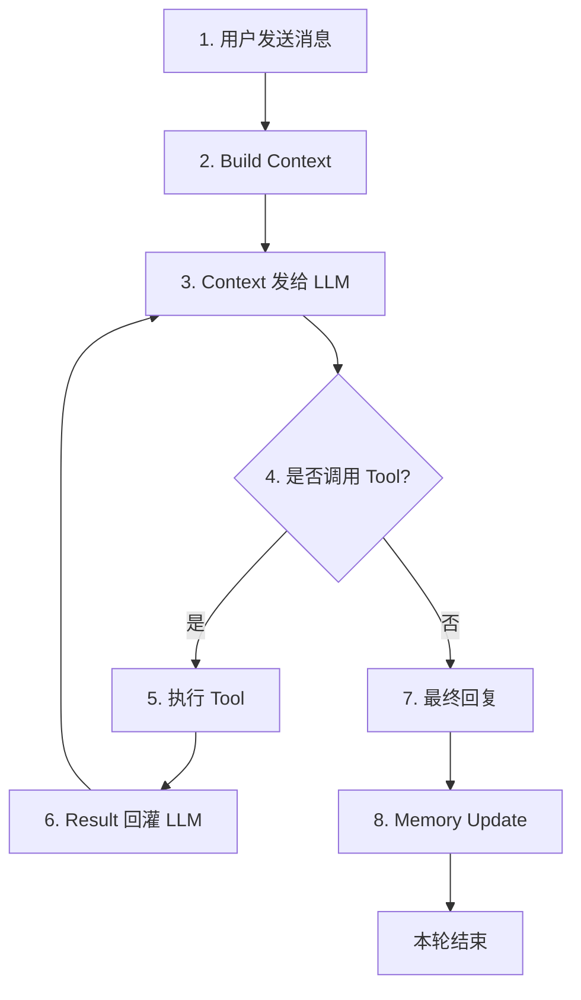
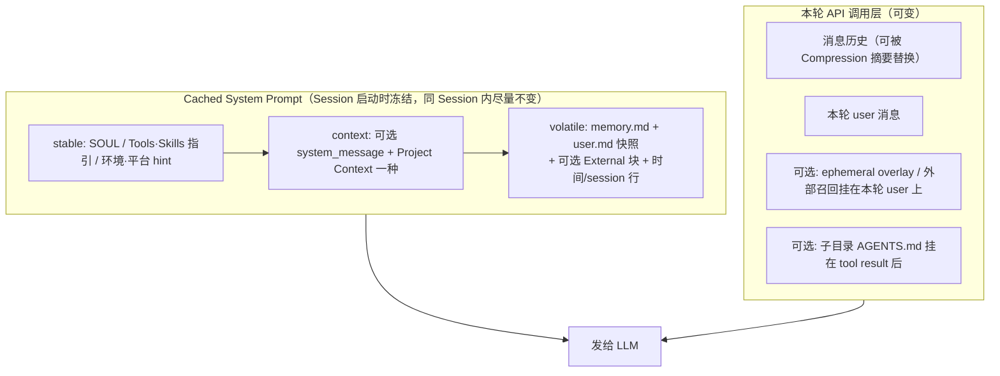

#是什么？一个类似openclaw这种个人助理的东西

1、内置了很多Geteway（链接两种不同网络协议之间的节点）和各种常用的插件  

2、循环步骤

2.1、如何 Build Content  （分层构建+拼接）

#部分含义解释
提示词冻结/cache：（OpenAI/Gemini 的隐式缓存机制）要求前缀逐字节相同，否则缓存失效
何时恢复：会话恢复、新会话、上下文压缩、模型切换（provider的缓存空间/机制都不同）

soul：你自己设定的agent身份/人格/行为准则
system_message:  调用方传入的基本信息和行为准则（cli/网页前端、外部程序调用-python脚本、外部agent、父调用子agent、切换模型）
project content: /hermes.md、Agents.md...
externa：外部的长期记忆
ephemer overlay：(临时指令，本质是在system尾部添加一段非冻结的提示词)
    - 改人格（不影响soul，内置了/personality指令 14种人格）
    - 改环境变量
    - 子agnet委派（父agent委派了什么任务，和冻结的sp是分开的）
外部召回：搜索/api数据/程序获取
tool_reult: 上轮工具调用结果，openai有独立的role=tool，其他的拼接到role=user后
子目录Agents.md：调用什么工具，该工具的md文档会拼接到tool result后
知识库获取方式：请求前自动获取(归属外部召回)、走tool工具(归属tool_reult)

2.2、压缩机制
1. 用 API 返回的真实 token 用量（不是估算）
2. prompt_tokens(本次请求的总输入token) ≥ 50% × 模型 context_length → 触发
3. 保护前 3 轮（system prompt、最初的请求、第一次回答）
4. 保护最后 N 轮（默认 20 条消息 ≈ 10 轮）
5. 中间的轮次用便宜快的模型摘要
6. 摘要作为一条 user 消息插入，对话无缝继续

  #摘要长什么样？
  一段结构化 markdown，开头声明"仅作背景，只响应之后的新消息"。区块：目标 / 约束 / 已完成（带日期）/ 进行中 / 阻塞 / 关键决策 / 相关文件 / 下一步。 每条一两行，只保留有价值的结论。二次压缩是更新上一份，不是重写。

 