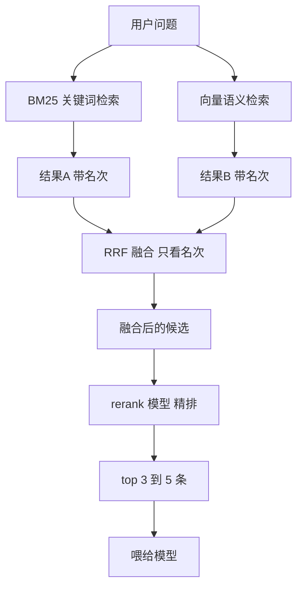

- 会话记忆
- 结构性文档
- 跨会话检索
   关键词：分词器 + BM25 (关键词搜索排序公式 )
   语义检索: 向量化 + 召回
   混合检索: BM25 + 向量 + RRF + 重排(rerank模型)
   RRF：根据名次换算成分数，两路相加，取分数高的n条
   重排：把n条候选，一条条拿去让一个专门的小模型判断"这段跟问题到底多相关"，按它的分数重新排队，只留下最相关的几条。

