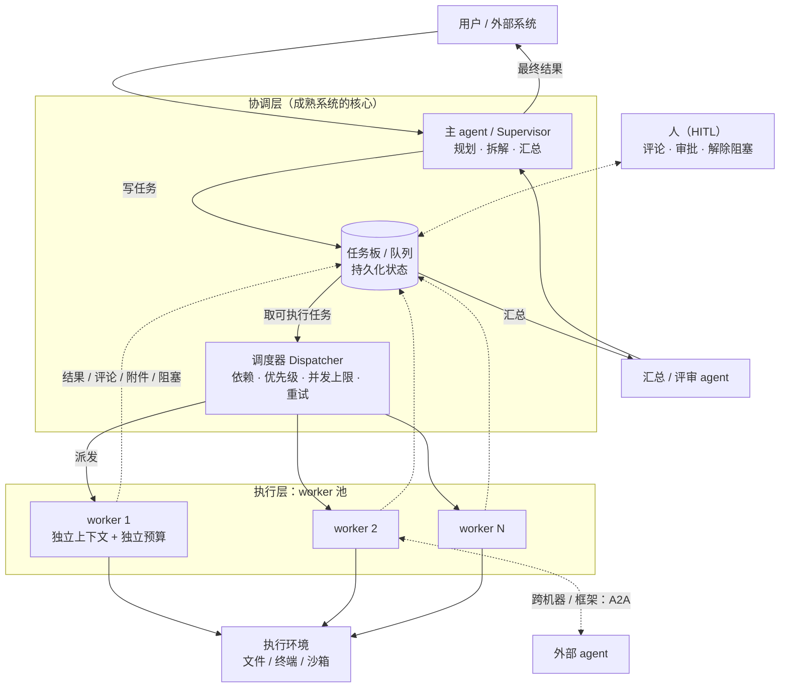
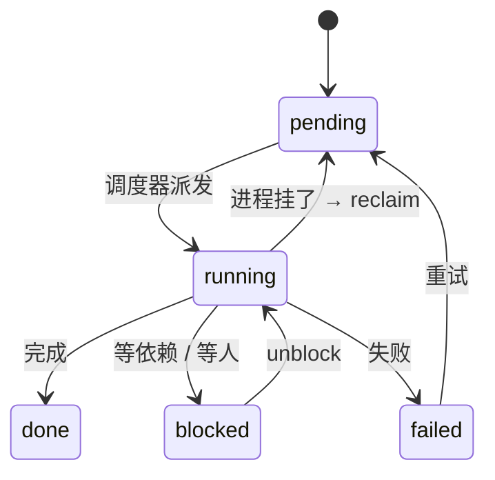

- 是什么：多个 agent 分工干活，不是一个全干（multi-agent / MAS）

- 两种协作形态
  主从：主 agent 拆任务 → 派给多个 worker → 汇总
  对等：agent 平级，互相协作

- 按跨度分三层
  同进程：临时子 agent（一次性）
  同机多身份：持久 agent（有名字、有记忆、能恢复）
  跨机器 / 框架：标准协议互通（A2A）

- 六个设计问题
  上下文怎么传 / 结果怎么汇合 / 怎么防循环 / 挂了怎么办 / 成本与并发 / 状态放内存还是放库

- 与子 agent 的关系：子 agent = 最简单的多 agent（主从）

- 什么时候值得：任务可拆且互相独立 / 一个上下文装不下 / 要并行

