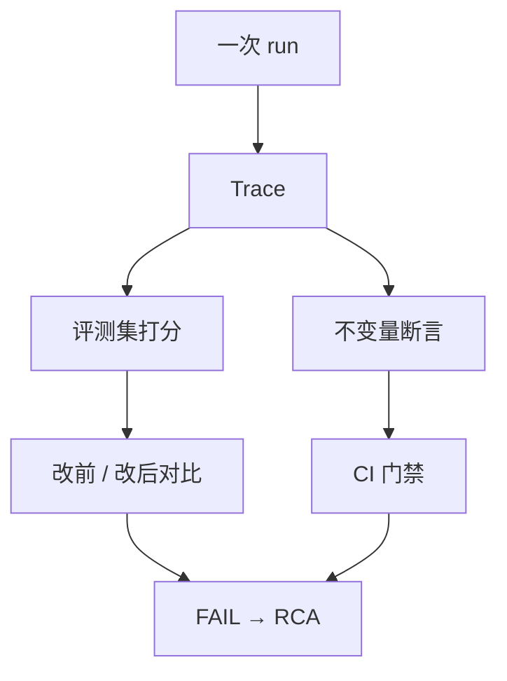

- 定位：给agent的稳定性、回复准确性做一系列单元测试、得分评估、线上指标。
- 测试框架：pytest、Jest、Vitest

- **三层：各管一件事，越往下越慢**
  单元 = 底线：只查"有没有破规矩"，判过 / 不过，不出分数；破了 CI 变红，PR 合不进主干
  任务 = 质量：跑一组带检查项的题，算通过率；通过率掉了，就是改坏了
  线上 = 真况：抽真实流量算指标；脚本里测不出来的问题，在这里露头
	
- **不变量（契约）**：不管怎么改代码都必须成立的过程规则
  举例：先读后写 / system 中途不变 / 工具表不增减 / 步数 ≤ 预算 / 禁用工具不出现
  为什么不用快照：换句话、换个模型就挂 —— 那只是"变更探测器"，不是契约
  判断标准：换个模型、换种措辞还成立 → 是契约；答案一变就变 → 不是

- **一条契约怎么落地（三步）**
  ① 定规则：用"必须 / 不允许"写，例："不允许连续两条 assistant"
  ② 写检查函数：输入轨迹，返回（是否通过, 原因）；放 checkers.py，不写进测试文件
  ③ 配两份样本：正常轨迹必须过（防误报），故意写坏的必须被抓（防漏报）
     只测一份不够 —— 函数永远返回 True 也全绿；只测负例，太敏感的误报也发现不了

- **为什么要拆成很多小方法**：一个方法 = 一条失败原因
  合并成一坨后，第一个断言挂了后面不执行，修一次跑一次；拆开能一次看全所有问题

- **评测集**：20~50 条，每条 = 输入 + 检查项；看完成率 / 步数 / token / 工具选对率
- **打分**：规则断言最稳 > judge 模型打分（有偏，要人工校准） > 人工抽检；开放式任务没有 golden answer
- **Trace**：一次 run 的完整记录（每轮消息 / 工具调用 / 用量）；专抓三类翻车：工具选错 / 上下文溢出 / 预算耗尽
- **Benchmark**：别人做好的大考卷 —— SWE-bench 改代码 / WebArena 网页 / τ-bench 工具调用 / GAIA 通用助理

- **Hermes 的做法**
  一句话：不做跑分，只做两件事 —— 旧坑不再犯、改动没变差
  单元层：tests/agent/ 下几千条 pytest，一条测一种错
    例：压缩完历史不能有连续两条 user；tool_call 后面必须跟一条 tool 结果
    破了 CI 变红，PR 合不进主干 —— 这就是上面说的"契约测试"
    例：message 结构（role 交替）—— 写在压缩器测试里内联断言
    拒收快照测试：换模型就误报，卡不住真问题
  任务层：evals/ 目录，一个子目录 = 一个真实场景（tool_search / compaction / token_accounting …）
    里面存着攒下来的真实会话，改完代码重跑一遍，对比改前改后 —— 等于上面说的"通过率有没有掉"
    为什么叫"回放"：用存下来的记录重检查，不再调模型，所以几秒就能跑完
  线上层：三个日志文件（agent.log / errors.log / gateway.log），每条带 session_tag
    出事按 tag 把一次会话的完整记录捞出来，不用猜
  入口：统一跑 scripts/run_tests.sh，不许裸 pytest（保证本地和 CI 环境一致）
  出事之后：把那次的错误数据抄进测试，加一条断言，以后自动跑
  课程 demo：03-eval —— 把这套做成可跑的小例子（role / system / tools / 预算）

**高频三问：**
1.  你怎么评估 agent 好不好？ 
     用户角度：uiux是否对我是友好的，能不能解决我的实际问题，然后就是收费/速度。
     技术角度：三层（单元、任务、线上），并说清各层解决什么问题。
      
2. 上线后怎么知道变差了？     
     trace + 线上指标 + 回放，不要答“看用户反馈”。
     
3. 一次失败的 run 你怎么查？  
     trace 三段：工具选对没、上下文有没有爆、预算有没有耗尽。